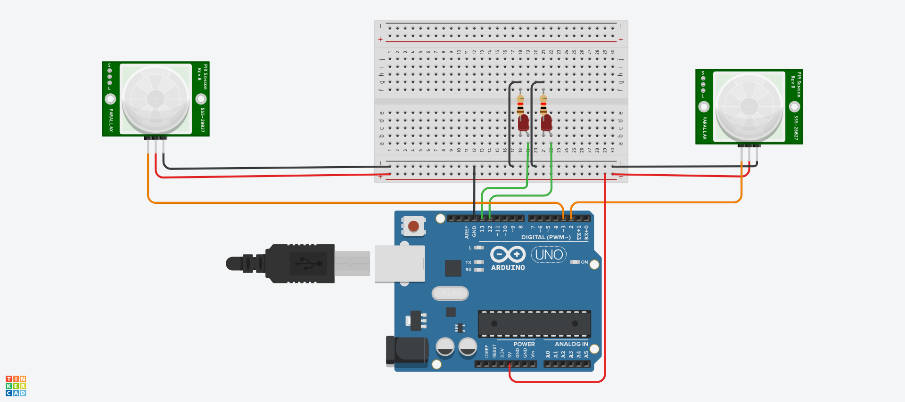

# PIR-Based Staircase Lighting System

Motion-activated staircase lighting for 12 steps. Two PIR sensors detect which
end someone entered from; the steps light up one by one in that direction, stay
on while motion continues, then switch off step by step in the direction walked.

📄 [Back to main README](../README.MD)


## Table of Contents
- [Features](#features)
- [Hardware Requirements](#hardware-requirements)
- [Pin Connections](#pin-connections)
- [Software Requirements](#software-requirements)
- [Installation Steps](#installation-steps)
- [System Operation](#system-operation)
- [Serial Commands](#serial-commands)
- [Debugging](#debugging)
- [Security Notes](#security-notes)
- [Maintenance](#maintenance)

## Features

✅ **Directional sweep** — bottom sensor lights steps bottom→top, top sensor lights top→bottom.
✅ **Direction locked per cycle** — no mid-cycle flip; predictable for one person at a time.
✅ **Hold while moving** — any sensor extends the on-time; lights stay on as long as someone moves.
✅ **Re-trigger during switch-off** — new motion mid-off-sweep re-lights straight away; steps still on stay on.
✅ **Follow-you off** — lights switch off in the direction you walked.
✅ **Safety cut-off** — everything off after 5 min if a sensor is stuck on (sun, heater).
✅ **Hard on/off via relays** — no fading, 12 steps, one relay per step.
✅ **Serial debugging** — fake motion, force states, query status over USB.

## Hardware Requirements
- Arduino Uno R3
- 16-channel relay board (SRD-12VDC relays) — channels 1–12 used, 13–16 spare
- 2× HC-SR501 PIR sensors (bottom + top of stairs)
- 12× LED strips (one per step), 5 V supply sized for your strips
- 12 V supply (≥1 A, 2 A comfortable) for the relay board
- Jumper wires; shared ground between Uno and relay board

## Pin Connections

| Uno pin | Goes to | Note |
|---------|---------|------|
| D2 … D12 | Relay IN1 … IN11 (steps 1–11) | Step 1 = bottom |
| A0 | Relay IN12 (step 12, top) | Analog pin as digital output |
| A1 | Bottom PIR OUT | |
| A2 | Top PIR OUT | |
| A3 | free | Light sensor later ("only when dark") |
| A4 / A5 | free (I2C) | PCF8575 / LCD later |
| D0 / D1 | USB serial | Debug now; Zigbee module later |
| D13 | **not used** | Bootloader blinks it at reset → would click a relay |
| 5V / GND | Both PIRs VCC / GND | PIRs draw almost nothing |



> Note: the wiring diagram above is from the 2-LED prototype and is stale for v1.
> Trust the pin table above until the diagram is redrawn.

## Software Requirements
- Arduino IDE (1.8+ or 2.x)

## Installation Steps
1. Wire the components per the pin table above.
2. Open `staircaselighting.ino` in the Arduino IDE.
3. Select **Arduino Uno** and the correct COM port.
4. For a first bench test without PIRs: set `USE_PIRS = false`, upload, open Serial Monitor at **115200 baud**, type `t`.
5. Add the relay board (12 V on, shared GND, IN1–IN12). Run `t`: relays 1→12 click in order. If inverted, set `RELAY_ACTIVE_LOW = false`.
6. Add the PIRs, set `USE_PIRS = true`, wait out the 45 s warm-up, wave at each sensor.

## System Operation
A non-blocking state machine runs the show (no `delay()` in the main loop):

```
IDLE → SWEEP_ON → HOLD → SWEEP_OFF → IDLE
```

- **IDLE**: all steps off. First PIR to fire starts a cycle; direction is set by which sensor (bottom→UP, top→DOWN) and locked for the whole cycle. Tie-break: bottom wins.
- **SWEEP_ON**: light one step every `STEP_DELAY_MS` (250 ms) in the locked direction. On reaching the far end → HOLD.
- **HOLD**: all steps on. Any motion resets the hold timer. After `HOLD_MS` (20 s) with no motion → SWEEP_OFF.
- **SWEEP_OFF**: turn off one step every `STEP_DELAY_MS`, in the direction walked (follow-you). On reaching the far end → IDLE.

**Re-trigger:** if motion arrives during SWEEP_OFF, the system jumps back to SWEEP_ON (same direction) and re-sweeps from the start. Steps that are still on stay on (idempotent writes); only the off ones light up again.

**Safety:** if a cycle stays active longer than `MAX_ON_MS` (5 min) — e.g. a sensor stuck on from sun or a heater — everything goes off and the system returns to IDLE.

## Serial Commands
Open Serial Monitor at **115200 baud**. Commands are single characters (no line ending needed):

| Key | Action |
|-----|--------|
| `u` | Fake bottom-sensor motion |
| `d` | Fake top-sensor motion |
| `o` | All steps on → HOLD (times out normally) |
| `x` | All steps off → IDLE |
| `t` | Test chase 1→12 (blocking) |
| `?` | Print current state |

During an active cycle, `u`/`d` count as motion (extend hold or reignite; direction does not flip). To force a direction, send `x` then `u`/`d`. These commands are also the hook for the Zigbee controller in v2.

## Debugging
Serial output at 115200 baud:
- State transitions (`-> SWEEP_ON UP`, `-> HOLD`, `-> SWEEP_OFF DOWN`, `-> IDLE`).
- Safety trips (`SAFETY: max-on reached, all off`).
- `?` for a full status snapshot (state, direction, step index, sensor states).

## Future Improvements (v2+)
- **"Only when dark":** LDR + 10 k resistor on A3.
- **LCD:** PCF8575 (or PCF8574 backpack) on A4/A5 for status + buttons.
- **16 steps:** move relays to the PCF8575 on I2C, freeing Uno pins.
- **Smart follow:** let the opposite sensor flip the sweep direction mid-cycle (currently locked).
- **Zigbee:** ESP32-C6/H2 sending `u`/`d`/`o`/`x` over serial.

## Security Notes
✔ Use **NO** contacts so lights stay off if the relay board loses power.
✔ Keep JD1–JD16 jumpers all the same (high/low trigger per channel).
✔ Shared ground between Uno and relay board — without it, control signals don't work.
✔ 12 V and 5 V supplies are separate; only the relay contacts carry the 5 V LED current.

## Maintenance
- Verify PIR alignment (each aimed at its own end, away from heaters/windows).
- Re-tune `STEP_DELAY_MS`, `HOLD_MS` and PIR sensitivity on the real stairs.
- Check serial output for unexpected SAFETY trips (indicates a stuck/misaimed sensor).
- Inspect relay and strip wiring for heat or looseness.
